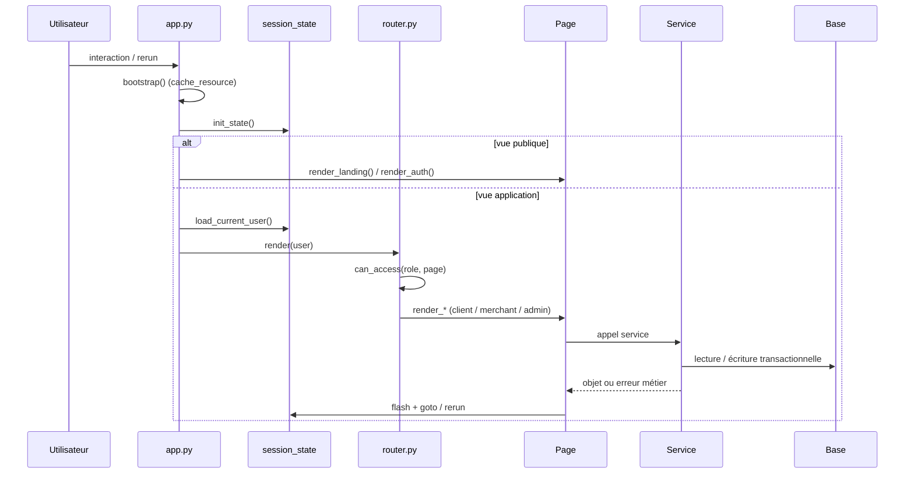
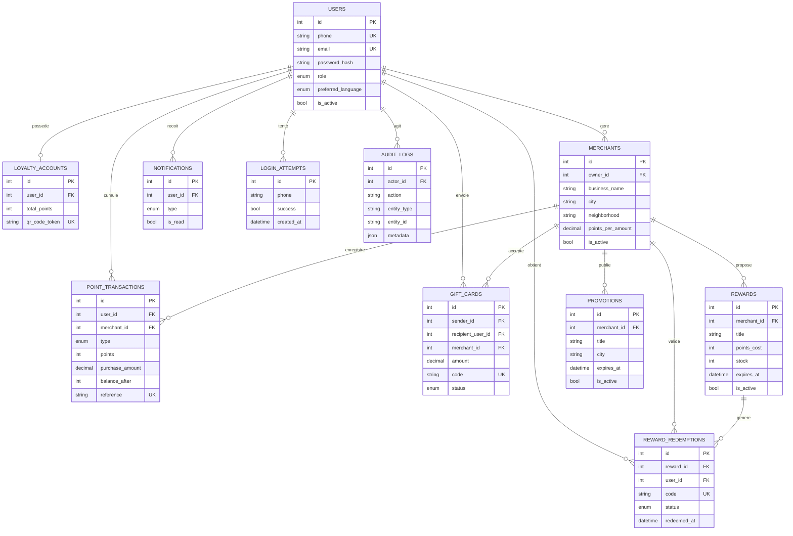
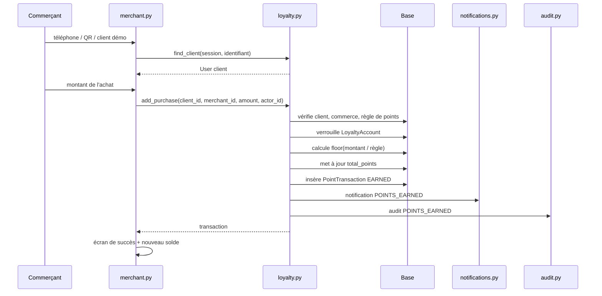

# Architecture WafaClub

Document de référence pour comprendre le fonctionnement interne du MVP, ses choix techniques et ses limites.

## 1. Vue d'ensemble

WafaClub est une application **Streamlit monolithique** organisée en couches :

```text
┌──────────────────────────────────────────────────────────────┐
│ app.py                                                       │
│ bootstrap DB + seed, configuration de page, routage public   │
└──────────────────────────────┬───────────────────────────────┘
                               │
┌──────────────────────────────▼───────────────────────────────┐
│ wafaclub/ui/                                                 │
│ public.py  client.py  merchant.py  admin.py                  │
│ router.py  state.py  theme.py  components.py  icons.py       │
└──────────────────────────────┬───────────────────────────────┘
                               │ appels Python
┌──────────────────────────────▼───────────────────────────────┐
│ wafaclub/services/                                           │
│ auth, loyalty, rewards, giftcards, promotions, merchants,    │
│ stats, admin, notifications, audit                           │
└──────────────────────────────┬───────────────────────────────┘
                               │ SQLAlchemy 2.0
┌──────────────────────────────▼───────────────────────────────┐
│ wafaclub/models.py · db.py · base.py                         │
│ SQLite (démo) ou PostgreSQL (pilote / production)            │
└──────────────────────────────────────────────────────────────┘
```

Chaque couche a une responsabilité unique :

| Couche | Responsabilité | Ne fait pas |
|---|---|---|
| `ui/` | Rendu Streamlit, navigation, formulaires, messages | Aucune règle métier, aucun accès SQL direct |
| `services/` | Règles métier, validations, transactions, audit | Aucun rendu, aucune dépendance à Streamlit |
| `models.py` | Schéma, contraintes, relations, invariants ORM | Aucune règle de présentation |
| `db.py` | Moteur, sessions, résolution SQLite | Aucune logique métier |
| `access.py` | Matrice rôle → pages | Aucune authentification |
| `security.py` | Hachage, normalisation, génération de codes | Aucune persistance |
| `i18n/` | Traductions et formatage | Aucune logique métier |

Cette séparation permet de tester les règles métier sans lancer Streamlit, et de changer l'interface
(Streamlit → autre framework) sans réécrire les services.

## 2. Cycle d'exécution Streamlit

Streamlit réexécute `app.py` à chaque interaction. Le cycle est le suivant :



### Bootstrap

`app.py` définit `bootstrap()` avec `@st.cache_resource` :

1. `database.create_all()` ;
2. si `WAFACLUB_AUTO_SEED=true`, ouverture d'une session et `seed_demo_data(session)`.

Le seed est idempotent : `seed_demo_data` vérifie si des utilisateurs existent déjà et retourne `skipped`.
Le cache évite de recréer les tables à chaque rerun.

### État de session

`wafaclub/ui/state.py` centralise les clés de `st.session_state` :

| Clé | Rôle |
|---|---|
| `lang` | Langue active (`fr`, `ar`; l'ancienne valeur `darija` retombe sur `fr`) |
| `view` | `landing`, `auth` ou `app` |
| `user_id` | Identifiant de l'utilisateur connecté |
| `merchant_id` | Commerce actif pour un compte commerçant |
| `page` | Page courante (clé `client.*`, `merchant.*`, `admin.*`) |
| `ctx` | Contexte de page (ex. `reward_id`, `promotion_id`) |
| `flash` | Message à afficher au prochain rendu |
| `pending_gift`, `pending_reward_id` | Étapes intermédiaires de formulaires |
| `last_purchase`, `last_validation`, `last_gift_validation` | Écrans de succès |

`SessionUser` est un **snapshot immuable** (`dataclass(frozen=True)`) chargé depuis la base à chaque rerun.
Il évite de garder une entité SQLAlchemy attachée à une session fermée.

### Routage et garde d'accès

`wafaclub/access.py` contient la matrice exhaustive :

```python
CLIENT_PAGES   = frozenset({...})
MERCHANT_PAGES = frozenset({...})
ADMIN_PAGES    = frozenset({...})
PAGE_ROLES     = {page: frozenset({role}), ...}
```

`router.render(user)` :

1. détermine la page demandée ou la page par défaut du rôle ;
2. vérifie `can_access(user.role, page)` ;
3. en cas de refus, affiche un avertissement et revient à la page par défaut ;
4. construit la sidebar (logo, utilisateur, sélecteur de commerce, navigation, langue, déconnexion) ;
5. affiche le flash puis appelle le module UI du rôle.

Les pages de détail et de formulaire sont rattachées à un parent via `PAGE_PARENT` pour conserver
l'élément de navigation actif.

## 3. Modèle de données



### Contraintes structurantes

- `users.phone` et `loyalty_accounts.qr_code_token` sont uniques.
- `point_transactions.points <> 0`, `balance_after >= 0`, `total_points >= 0`.
- `rewards.points_cost > 0`, `stock >= 0`, `expires_at > starts_at`.
- `gift_cards.amount BETWEEN 20 AND 2000`.
- Index composites pour les requêtes fréquentes :
  `(user_id, created_at)`, `(merchant_id, created_at)`, `(user_id, is_read, created_at)`,
  `(city, category)`, `(city, expires_at)`.

### Journal des points append-only

Invariants :

1. `loyalty_accounts.total_points == sum(point_transactions.points)` pour chaque utilisateur ;
2. `balance_after` correspond au solde après application de la ligne ;
3. aucune ligne ne peut être modifiée ou supprimée.

Le troisième invariant est garanti par deux écouteurs ORM dans `models.py` :

```python
@event.listens_for(PointTransaction, "before_update")
def _block_point_transaction_update(...):
    raise ImmutableLedgerError(...)

@event.listens_for(PointTransaction, "before_delete")
def _block_point_transaction_delete(...):
    raise ImmutableLedgerError(...)
```

Les corrections se font par **contre-écriture** :

- `REFUND` : remboursement d'un achat ;
- `ADJUSTMENT` : correction manuelle ;
- `EXPIRED` : expiration de points ;
- `REDEEMED` : consommation de points pour une récompense.

### Transactions et concurrence

- `database.session()` ouvre une session, commit à la sortie, rollback en cas d'exception.
- Les opérations sensibles utilisent `with_for_update()` sur le compte de fidélité ou la carte cadeau
  (verrouillage effectif sur PostgreSQL ; SQLite sérialise les écritures).
- Les services appellent `session.flush()` pour obtenir les identifiants, mais ne commitent pas :
  le contexte `database.session()` est la seule frontière transactionnelle.

## 4. Services métier

| Service | Fonctions principales | Invariants |
|---|---|---|
| `auth` | inscription, authentification, profil, langue | téléphone normalisé, mot de passe fort, limitation des tentatives |
| `loyalty` | calcul, achat, journal, remboursement, ajustement, expiration | solde non négatif, journal cohérent |
| `rewards` | catalogue, CRUD, rédemption, validation | propriétaire du commerce, stock, dates, code unique, non-réutilisation |
| `giftcards` | création, vérification, validation, expiration | montant 20–2 000, périmètre, code unique, statut |
| `promotions` | catalogue, CRUD, activation | propriétaire du commerce, dates |
| `merchants` | commerces, profil, activation | propriétaire ou admin |
| `stats` | tableaux de bord et agrégats | lecture seule |
| `admin` | listes et actions modérées | rôle admin |
| `notifications` | création, lecture, compteur | appartenance à l'utilisateur |
| `audit` | journal d'actions sensibles | append-only applicatif |

### Flux d'ajout de points



### Flux de rédemption d'une récompense

1. Le client choisit une récompense du catalogue.
2. `redeem_reward` vérifie l'activation, les dates, le stock, le solde et le commerce.
3. Le compte est débité, une ligne `REDEEMED` est ajoutée au journal.
4. Une `RewardRedemption` `PENDING` est créée avec un code aléatoire `RWD-…`, valable 30 jours.
5. Le commerçant saisit le code ; `validate_redemption` vérifie le commerce, l'expiration et le statut.
6. La rédemption passe à `USED`, une notification est envoyée au client.

### Flux carte cadeau

1. Le client choisit un montant (20–2 000 MAD), un destinataire et un périmètre.
2. Le paiement est **simulé** : la carte est immédiatement `ACTIVE` avec `PAID_SIMULATED`.
3. Un code `WFC-…` unique est généré (alphabet sans caractères ambigus).
4. Si le destinataire est un utilisateur connu, il reçoit une notification.
5. Le commerçant vérifie le code, puis le valide : la carte passe à `USED`.
6. Les cartes expirées sont rafraîchies à la lecture (`refresh_expired_cards`).

## 5. Internationalisation et design

### i18n

- Deux fichiers JSON : `fr.json` (référence) et `ar.json`.
- `t(key, lang, **kwargs)` :
  1. cherche dans la langue demandée ;
  2. retombe sur le français ;
  3. retombe sur la clé elle-même (jamais d'exception).
- `format_mad`, `format_date`, `format_datetime`, `format_points` centralisent les formats.
- L'arabe active `is_rtl("ar")` et l'injection de `rtl_css()` dans `theme.py`.
- Les tests vérifient la parité FR/AR et la cohérence des placeholders.

### Design system

- Couleurs : bleu profond (`#0B3C6E`), or (`#D99A2B`), vert (`#12805C`), fond clair (`#F4F7FB`).
- Composants : cartes arrondies, badges, stat cards, empty states, bannières, code boxes.
- CSS injecté via `st.markdown(..., unsafe_allow_html=True)`.
- Contenu utilisateur échappé avec `esc()` avant injection HTML.
- Icônes SVG maison inspirées de Lucide, plus quelques emojis de navigation.

## 6. Gestion des erreurs

Toutes les erreurs métier héritent de `WafaClubError` et portent un `code` stable :

| Exception | Usage | Exemple de code |
|---|---|---|
| `ValidationError` | entrée invalide | `invalid_amount`, `invalid_phone` |
| `AuthError` | authentification | `invalid_credentials`, `account_locked` |
| `AccessDenied` | droits insuffisants | `page_forbidden`, `merchant_access_denied` |
| `NotFoundError` | ressource absente | `reward_not_found`, `giftcard_not_found` |
| `ConflictError` | conflit d'état | `reward_already_used`, `giftcard_expired` |
| `ImmutableLedgerError` | violation du journal | `immutable_ledger` |

L'UI appelle `ui.show_error(error, lang)` qui :

1. tente de traduire `errors.<code>` via i18n ;
2. retombe sur le message brut de l'exception ;
3. affiche `st.error(...)` sans interrompre la page.

## 7. Déploiement

### Local

```bash
streamlit run app.py
```

SQLite : `data/wafaclub.db`, créé automatiquement.

### Docker

- Image `python:3.11-slim`, utilisateur non-root `appuser`.
- `HEALTHCHECK` sur `/_stcore/health`.
- Volume `/app/data` pour SQLite.
- Profil Compose `postgres` pour une variante PostgreSQL.

### Production cible

```text
Internet ── HTTPS ──► Reverse proxy / CDN
                         │
                         ▼
                 Streamlit (1+ instances)
                         │
                         ▼
                 PostgreSQL managé
                         │
                         ├── sauvegardes chiffrées
                         ├── supervision / alertes
                         └── migrations Alembic
```

Points à ajouter avant un pilote : fournisseur d'identité, vérification SMS, rate limiting par IP,
secrets managés, migrations versionnées, sauvegardes, journalisation centralisée, WAF, tests de charge.

## 8. Décisions techniques (ADR condensé)

| Décision | Choix | Justification | Conséquence |
|---|---|---|---|
| Framework UI | Streamlit | rapidité de démonstration, Python unique | moins de contrôle fin qu'un front dédié |
| Base locale | SQLite | zéro installation, démo instantanée | écritures sérialisées, pas de haute dispo |
| Base cible | PostgreSQL | robustesse, transactions, `FOR UPDATE` | ajouter Alembic et pool de connexions |
| Auth | maison (scrypt + téléphone) | pas de dépendance externe pour le MVP | remplacer par un IdP en production |
| Journal | append-only | confiance, auditabilité | corrections par contre-écritures |
| Codes | `secrets`, alphabet non ambigu | sécurité + lisibilité | vérification d'unicité en base |
| i18n | JSON centralisé | simplicité, parité testable | pas de CMS de traduction |
| Paiement | simulé | conformité et périmètre de démo | aucune valeur monétaire réelle |

## 9. Stratégie de test

- **Tests unitaires backend** : auth, fidélité, récompenses, cartes cadeaux, accès, seed/stats, i18n/QR.
- **Test d'intégration UI** : `tests/test_ui_smoke.py` lance l'app réelle avec `AppTest` sur une base temporaire.
- **Fixtures** : `tests/conftest.py` crée une base SQLite isolée par test, avec des fabriques de clients,
  commerçants, points et récompenses.
- **Non couvert** : navigateur réel, accessibilité, charge, tests de sécurité offensifs, PostgreSQL CI.

Voir [API.md](API.md), [SECURITY.md](SECURITY.md) et [DEMO.md](DEMO.md).
